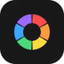
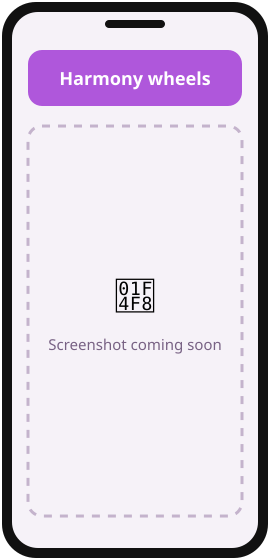
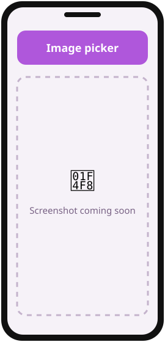
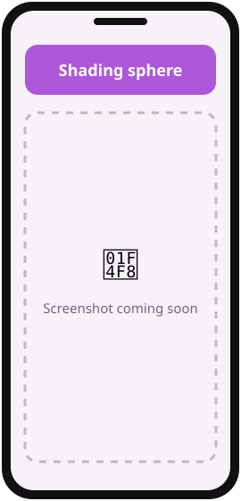

<div align="center">



# ColorFlows

**Color harmonies, palettes from pictures and a painter's shading sphere, for Android.**

  

[](https://github.com/Iurika-N-T-R/ColorFlows/releases/latest)
[](https://github.com/Iurika-N-T-R/ColorFlows/releases)
[](LICENSE)
[](https://github.com/Iurika-N-T-R/ColorFlows/stargazers)

[**⬇️ Download**](#download) · [**📸 Screenshots**](#screenshots) · [**✨ Features**](#features) · [**🛠️ Build**](#build)

</div>

---

<a id="screenshots"></a>

## 📸 Screenshots

<!-- TODO: replace docs/assets/screenshot-N.svg with real screenshots (same size for all, e.g. 1080x2400) -->
<div align="center">
<table>
  <tr>
    <td align="center"><br><sub><b>Harmony wheels</b></sub></td>
    <td align="center"><br><sub><b>Image picker</b></sub></td>
    <td align="center"><br><sub><b>Shading sphere</b></sub></td>
  </tr>
</table>
</div>

---

## 💡 What is ColorFlows?

ColorFlows helps **painters and digital artists** find colors that work together — from a harmony wheel,
from a picture, or from a shading sphere — **without a heavy app full of ads**.
It is free, open source, works offline, has zero dependencies and contains no ads or trackers.

### 👥 Who is it for?

- 🎨 **Painters** who think in RYB: on the painter's wheel, the complement of red is green
- 🖌️ **Digital artists & illustrators** building palettes and checking light and shadow
- 🧑‍🎨 **Designers** who want HEX values from a picture in two taps

---

<a id="features"></a>

## ✨ Features

| | Feature | Description |
|:-:|---|---|
| 🎡 | **RGB / RYB wheels** | Complementary, monochrome, analogous, split, triad, square, rectangle, compound |
| 🖼️ | **Palette from a picture** | Touch to pick a color, or extract the main colors |
| 🔮 | **Shading sphere** | A ball painted with your shadow, midtone and light colors |
| 🌊 | **Try your palette** | Dots, shapes, waves, gradients and proportions |
| 💾 | **Saved palettes** | Rename, copy HEX, share, delete |
| 🔒 | **Private by design** | No internet, no dependencies — your data stays on your device |

<details>
<summary><b>📖 How it works</b></summary>

- **RVB / RYB wheels**: complementary, monochrome, analogous, analogous + accent, split complementary, triad, square, rectangle and compound harmonies. Drag any marker to turn the whole harmony. On the RYB (painter's) wheel, the complement of red is green. In monochrome, each color moves on its own and the slider sets the value of the one you touched.
- **IMAGE**: touch a picture to pick the color under your finger, or use its main colors. Palettes take as many colors as you like.
- **SPHÈRE**: a ball painted with three colors of your own (shadow, midtone, light): tap one and set it with the sliders, or type the midtone and let "Auto" work out the other two. Touch the ball to pick a shade, then "Ajouter" keeps it.
- **Modifier les couleurs**: try a palette on dots, shapes, waves, gradients and flat proportions. Drag the bar to change how much of each color, and roll the dice to reshuffle.
- **Palettes**: saved on the phone. You can rename, copy the HEX values, share or delete them.
- Type any color in HEX or RGB.
- Share an image to ColorFlows to open it in the IMAGE tab.

The interface is in French.

</details>

---

<a id="download"></a>

## ⬇️ Download

<div align="center">

<a href="https://github.com/Iurika-N-T-R/iurikaFlows/releases/latest">
  
</a>
&nbsp;
<a href="https://github.com/Iurika-N-T-R/ColorFlows/releases/latest">
  
</a>

</div>

### 🟢 Recommended: with iurikaFlows (automatic updates)

1. Install **iurikaFlows** → [download here](https://github.com/Iurika-N-T-R/iurikaFlows/releases/latest).
2. Open it and find **ColorFlows** in *Découvrir*.
3. Tap **Install**. Future updates arrive automatically. ✅

### 🔵 Manual install (APK)

1. Go to the [**latest release**](https://github.com/Iurika-N-T-R/ColorFlows/releases/latest).
2. Under **Assets**, download the file ending in **`.apk`**.
3. Open it on your phone. If Android asks, allow **"Install unknown apps"** for your browser/file manager.
4. Tap **Install**. Done! 🎉

<details>
<summary><b>❓ Why isn't it on the Play Store?</b></summary>
<br>
ColorFlows is an independent, free project. Instead of the Play Store, it is distributed through
GitHub Releases and <b>iurikaFlows</b>, a small open-source store that keeps all my apps up to date.
The APKs are built from this public source code — you can check everything.
</details>

<details>
<summary><b>🛡️ Is it safe? Android says "unknown source"</b></summary>
<br>
This warning appears for every app installed outside the Play Store. The code is 100% public in this repository,
and each release is signed with the same key, so Android will refuse any modified version.
</details>

> **Requirements:** Android 8.0+ · ~0.6 MB

---

<a id="build"></a>

## 🛠️ Build from source

<details>
<summary><b>For developers — click to expand</b></summary>

**Prerequisites:** [Android Studio](https://developer.android.com/studio) (latest) or the Android SDK (platform 36) · JDK 17–21

```bash
git clone https://github.com/Iurika-N-T-R/ColorFlows.git
cd ColorFlows
./gradlew assembleDebug
```

The APK is generated in `app/build/outputs/apk/debug/`.

**Signed release:** `./gradlew assembleRelease` signs the APK only if a git-ignored `keystore.properties`
(`storeFile`, `storePassword`, `keyAlias`, `keyPassword`) sits at the project root; otherwise it comes out unsigned.

</details>

---

## 🤝 Contributing

Ideas, bugs, translations — all contributions are welcome!

- 🐛 **Found a bug?** → [Open an issue](https://github.com/Iurika-N-T-R/ColorFlows/issues/new)
- 💡 **Have an idea?** → [Open an issue](https://github.com/Iurika-N-T-R/ColorFlows/issues) and describe it
- ⭐ **Like it?** → A star on this repo helps other people find it!
- ☕ **Want to support the work?** → [Buy me a coffee](https://buymeacoffee.com/iurika)

---

## 🧩 More apps by Iurika-N-T-R

<!-- Same block in EVERY repo: cross-linking boosts visibility of all the projects -->
| App | Description |
|---|---|
| [**iurikaFlows**](https://github.com/Iurika-N-T-R/iurikaFlows) | My open-source app store — installs and updates all my apps |
| [**DroRef**](https://github.com/Iurika-N-T-R/DroRef) | Reference board for artists, opens and saves PureRef `.pur` files |
| [**OnlyFlows**](https://github.com/Iurika-N-T-R/OnlyFlows) | Offline-first task & project manager with LAN sync |
| [**galleryFlows**](https://github.com/Iurika-N-T-R/galleryFlows) | Gallery that browses your real folder tree |
| [**vidéoFlows**](https://github.com/Iurika-N-T-R/videoFlows) | Your own videos in a vertical swipe feed |
| [**RandomFlows**](https://github.com/Iurika-N-T-R/RandomFlows) | Randomizer & decision maker on your own lists |
| [**Brush Converter**](https://github.com/Iurika-N-T-R/ABR-to-PRZP-Brush-converter) | Photoshop `.abr` brushes → Infinite Painter `.przp`, in the browser |

---

<div align="center">

📄 Released under the **[MIT License](LICENSE)**

Made with ❤️ by [**Iurika-N-T-R**](https://github.com/Iurika-N-T-R)

<sub>If ColorFlows is useful to you, consider giving it a ⭐ — it really helps!</sub>

</div>
